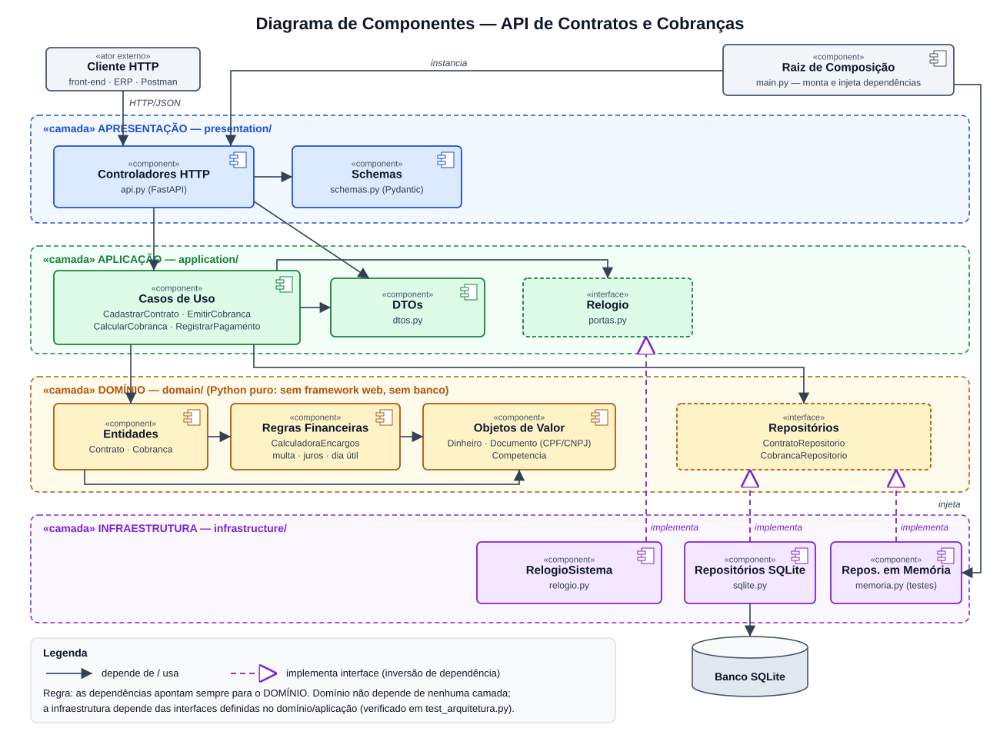

# API de Contratos e Cobranças — Arquitetura em Camadas

Protótipo funcional (Python + FastAPI + SQLite) da reorganização de uma API de gerenciamento de
contratos, emissão de cobranças e cálculo de multa e juros por atraso, usando **arquitetura em camadas**.

* 📄 Relatório técnico: [`docs/RELATORIO.md`](docs/RELATORIO.md) (versão PDF: [`docs/relatorio-tecnico.pdf`](docs/relatorio-tecnico.pdf))
* 🧩 Diagrama de componentes: [`docs/diagrama-componentes.png`](docs/diagrama-componentes.png) · [`.svg`](docs/diagrama-componentes.svg) · [`.puml`](docs/diagrama-componentes.puml)



## Estrutura

```
src/cobrancas/
├── domain/            # Domínio (Python puro): entidades, objetos de valor, regras financeiras, interfaces
│   ├── entidades.py       Contrato, Cobranca
│   ├── valores.py         Dinheiro, Documento (CPF/CNPJ), Competencia
│   ├── regras.py          CalculadoraEncargos (multa, juros, dia útil)
│   ├── repositorios.py    interfaces ContratoRepositorio / CobrancaRepositorio
│   └── excecoes.py
├── application/       # Aplicação: casos de uso, DTOs, portas (Relogio)
├── infrastructure/    # Infraestrutura: repositórios SQLite e em memória, relógio
├── presentation/      # Apresentação: rotas FastAPI e schemas Pydantic
└── main.py            # Raiz de composição (injeção de dependências)
tests/
├── unit/              # cálculo, validações, casos de uso, regras de arquitetura
└── integration/       # API HTTP ponta a ponta
```

## Executar

```bash
pip install -r requirements.txt
pytest
uvicorn cobrancas.main:criar_aplicacao --factory --app-dir src --reload
```

Documentação interativa (Swagger): http://127.0.0.1:8000/docs

## Endpoints

| Método | Rota | Descrição |
|---|---|---|
| POST | `/contratos` | Cadastra contrato |
| GET | `/contratos` | Lista contratos |
| GET | `/contratos/{id}` | Consulta contrato |
| POST | `/contratos/{id}/cobrancas` | Emite cobrança da competência (`{"competencia": "2026-11"}`) |
| GET | `/contratos/{id}/cobrancas` | Lista cobranças do contrato |
| GET | `/cobrancas/{id}/calculo?data_referencia=AAAA-MM-DD` | Valor atualizado com multa e juros |
| POST | `/cobrancas/{id}/pagamento` | Registra pagamento (`{"data_pagamento": "AAAA-MM-DD"}`, opcional) |

Erros de negócio retornam `{"detalhe": "..."}` com status **404** (não encontrado),
**409** (conflito/duplicidade) ou **422** (validação/regra de negócio).

### Exemplo

```bash
curl -X POST localhost:8000/contratos -H 'content-type: application/json' -d '{
  "cliente_nome": "Empresa Exemplo Ltda", "cliente_documento": "11.222.333/0001-81",
  "descricao": "Suporte técnico mensal", "valor_mensal": "1500.00", "dia_vencimento": 10,
  "data_inicio": "2026-01-01", "data_fim": "2026-12-31"}'

curl -X POST localhost:8000/contratos/1/cobrancas -H 'content-type: application/json' -d '{"competencia": "2026-11"}'

curl "localhost:8000/cobrancas/1/calculo?data_referencia=2026-12-25"
# {"dias_atraso":45,"multa":"30.00","juros":"22.50","total":"1552.50", ...}
```

## Regras financeiras

* **Multa:** percentual fixo (padrão 2%, máx. 2%) sobre o valor original, aplicada uma vez.
* **Juros de mora:** simples, *pro rata die* (padrão 1% a.m., máx. 1%), mês comercial de 30 dias.
* **Vencimento em fim de semana:** prorrogado para o próximo dia útil.
* **Valores monetários:** `Decimal`, arredondamento *half-up* em centavos.
