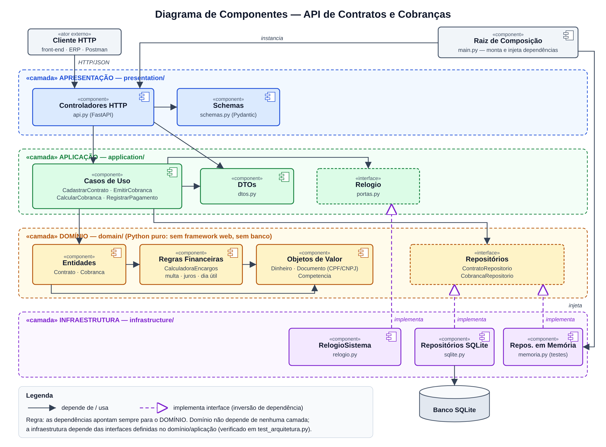

# Relatório Técnico — Reorganização da API de Contratos e Cobranças em Arquitetura em Camadas

**Disciplina:** ADS1243 — Design de Software
**Entrega:** código-fonte, diagrama arquitetural, testes automatizados e relatório técnico

---

## 1. Contexto e problema

A API atual da empresa gerencia contratos, emite cobranças e calcula multas por atraso. Os
controladores HTTP fazem tudo: consultam o banco de dados diretamente, calculam valores
financeiros e validam regras de negócio. Um controlador típico da situação atual seria assim:

```python
@app.post("/cobrancas/{id}/pagar")
def pagar(id: int):
    row = db.execute("SELECT * FROM cobrancas WHERE id = ?", (id,)).fetchone()  # SQL no controlador
    atraso = (date.today() - date.fromisoformat(row["vencimento"])).days          # regra de negócio
    total = row["valor"] * 1.02 + row["valor"] * 0.01 / 30 * atraso if atraso > 0 else row["valor"]  # float!
    db.execute("UPDATE cobrancas SET pago = 1, valor_pago = ? WHERE id = ?", (total, id))
    return {"total": total}
```

Problemas desse modelo:

* **Acoplamento:** a regra de multa/juros só existe "dentro" de uma rota HTTP; para reutilizá-la
  (num job batch, num relatório) é preciso copiar código.
* **Testabilidade baixa:** testar o cálculo exige subir o servidor e um banco de dados.
* **Erros financeiros:** uso de `float` gera arredondamentos incorretos em centavos.
* **Regras espalhadas:** validações duplicadas e inconsistentes entre endpoints.

## 2. Proposta: arquitetura em camadas

A aplicação foi reorganizada em quatro camadas, com a regra de que **as dependências apontam
sempre para o domínio** (inspiração em *Clean Architecture* / *Hexagonal*):

| Camada | Pasta | Responsabilidade | Pode depender de |
|---|---|---|---|
| **Apresentação** | `src/cobrancas/presentation/` | Rotas HTTP (FastAPI), schemas de entrada/saída (Pydantic), tradução de exceções em códigos HTTP | Aplicação, Domínio (exceções) |
| **Aplicação** | `src/cobrancas/application/` | Casos de uso (`CadastrarContrato`, `EmitirCobranca`, `CalcularCobranca`, `RegistrarPagamento`...), DTOs e portas (`Relogio`) | Domínio |
| **Domínio** | `src/cobrancas/domain/` | Entidades (`Contrato`, `Cobranca`), objetos de valor (`Dinheiro`, `Documento`, `Competencia`), regras financeiras (`CalculadoraEncargos`), interfaces de repositório | Nada (Python puro) |
| **Infraestrutura** | `src/cobrancas/infrastructure/` | Repositórios SQLite e em memória, relógio do sistema | Domínio, Aplicação (portas) |
| *Raiz de composição* | `src/cobrancas/main.py` | Instancia as implementações concretas e injeta nos casos de uso | Todas |

### 2.1 Diagrama de componentes



Fontes do diagrama: `docs/diagrama-componentes.svg` e `docs/diagrama-componentes.puml` (PlantUML).

Pontos principais do diagrama:

* As setas sólidas (uso) descem da Apresentação para a Aplicação e da Aplicação para o Domínio.
* A Infraestrutura **não é usada diretamente** pelas camadas superiores: ela *implementa*
  interfaces (`ContratoRepositorio`, `CobrancaRepositorio`, `Relogio`) definidas no domínio e na
  aplicação — é a **inversão de dependência** (o "D" do SOLID).
* Só o `main.py` conhece as classes concretas e faz a ligação entre elas.

### 2.2 Fluxo de uma requisição (exemplo: calcular cobrança em atraso)

1. `GET /cobrancas/1/calculo?data_referencia=2026-12-25` chega ao **controlador** (`api.py`).
2. O controlador chama o caso de uso **`CalcularCobranca.executar(1, date(2026,12,25))`**.
3. O caso de uso busca a cobrança pela **interface** `CobrancaRepositorio` (em produção, a
   implementação SQLite; nos testes, a de memória).
4. A entidade **`Cobranca.calcular()`** delega para a **`CalculadoraEncargos`** (domínio puro).
5. O resultado (`Demonstrativo`) volta como **DTO** e o controlador o converte em JSON.

## 3. Regras de negócio implementadas

### 3.1 Cadastro de contratos (validações)

* Nome do cliente com ao menos 3 caracteres; descrição obrigatória.
* **CPF ou CNPJ** válidos (cálculo dos dígitos verificadores); armazenados só com dígitos.
* Valor mensal maior que zero (tipo `Decimal`, arredondado em centavos).
* Dia de vencimento entre 1 e 28 (existe em todos os meses).
* Data de fim posterior à data de início.
* Multa entre 0% e 2% (limite do art. 52, §1º, do CDC) e juros entre 0% e 1% ao mês.

### 3.2 Emissão de cobranças

* Uma cobrança por **competência** (`AAAA-MM`) por contrato — duplicidade retorna **409**.
* A competência deve estar dentro da vigência do contrato.
* Vencimento = dia de vencimento do contrato no mês da competência.
* As taxas de multa e juros são **copiadas** para a cobrança: mudanças posteriores no contrato
  não alteram cobranças já emitidas.

### 3.3 Cálculo de multa e juros por atraso

| Regra | Fórmula / comportamento |
|---|---|
| Multa moratória | `valor × multa%`, aplicada **uma única vez** se houver atraso |
| Juros de mora | Juros **simples** *pro rata die*: `valor × juros% × dias_atraso / 30` |
| Vencimento em fim de semana | Prorrogado para o próximo dia útil; se pago após a prorrogação, o atraso conta desde o vencimento original |
| Arredondamento | Cada parcela é arredondada em centavos (*half-up*), usando `Decimal` |
| Cobrança paga | Valor congelado na data do pagamento; não pode ser paga duas vezes; data de pagamento não pode ser futura |

**Exemplo:** cobrança de R$ 1.500,00 vencida em 10/11/2026 e paga em 25/12/2026 (45 dias):
multa = 1.500 × 2% = **R$ 30,00**; juros = 1.500 × 1% × 45/30 = **R$ 22,50**;
total = **R$ 1.552,50**.

### 3.4 Independência do framework e do banco (requisito 3)

* O pacote `domain/` não importa FastAPI, Pydantic, `sqlite3` nem outra camada. Isso é
  **verificado automaticamente** pelo teste `tests/unit/test_arquitetura.py`, que analisa os
  imports de cada camada (via `ast`) e falha se alguma regra de dependência for violada.
* A data "de hoje" vem da porta `Relogio`, e não de `date.today()` dentro da regra — o cálculo
  é determinístico e testável.
* Trocar SQLite por PostgreSQL, ou FastAPI por outro framework, exige alterar apenas
  `infrastructure/` ou `presentation/` e o `main.py`.

## 4. Testes automatizados

Executar: `pytest` — **77 testes, todos passando**.

| Arquivo | Tipo | O que cobre |
|---|---|---|
| `tests/unit/test_calculo_encargos.py` | Unitário (domínio) | Sem atraso, 1/30/45/90 dias, multa única, juros simples, arredondamento, fim de semana, taxas personalizadas e limites |
| `tests/unit/test_validacoes.py` | Unitário (domínio) | `Dinheiro`, CPF/CNPJ, competência, validações do contrato, vigência, pagamento duplicado |
| `tests/unit/test_casos_de_uso.py` | Unitário (aplicação) | Casos de uso com repositórios em memória e relógio fixo: duplicidade, não encontrado, data futura, persistência do pagamento |
| `tests/unit/test_arquitetura.py` | Arquitetural | Regras de dependência entre camadas |
| `tests/integration/test_api.py` | Integração | Fluxo HTTP completo com SQLite em memória e mapeamento de erros (404, 409, 422) |

Os testes de domínio não precisam de servidor nem banco: rodam em milissegundos.

## 5. Vantagens e limitações da arquitetura escolhida

### Vantagens

1. **Regras de negócio isoladas e testáveis.** O cálculo de multa e juros e as validações vivem
   no domínio, em Python puro. São testados com testes unitários rápidos, sem HTTP nem banco, e
   podem ser reaproveitados por outros canais (job de cobrança em lote, fila de mensagens, CLI)
   sem duplicação de código.
2. **Baixo acoplamento e facilidade de manutenção/troca de tecnologia.** Cada camada tem uma
   responsabilidade clara e as dependências apontam para o domínio. Trocar o banco (SQLite →
   PostgreSQL) ou o framework web afeta apenas a camada de infraestrutura ou de apresentação;
   uma mudança na regra de juros afeta apenas `domain/regras.py`.

### Limitações

1. **Mais código e indireção.** Há mais arquivos e mapeamentos (schema Pydantic → DTO → entidade
   → linha do banco e o caminho inverso). Para operações simples (um CRUD), isso gera código
   repetitivo e uma curva de aprendizado maior para novos desenvolvedores; requer disciplina da
   equipe para não "pular" camadas.
2. **Custo de desempenho e de recursos de persistência.** Como o domínio não conhece o banco,
   não se aproveitam diretamente recursos do SGBD (consultas otimizadas, cálculos em SQL,
   *lazy loading* de ORM). Relatórios com grande volume (ex.: total em atraso de milhares de
   contratos) tendem a carregar entidades em memória, sendo preciso criar consultas específicas
   de leitura (ex.: CQRS) para não perder desempenho. Além disso, o protótipo considera apenas
   fins de semana como dias não úteis — feriados exigiriam uma nova porta (calendário) na infraestrutura.

## 6. Como executar

```bash
pip install -r requirements.txt
pytest                                   # roda os testes
uvicorn cobrancas.main:criar_aplicacao --factory --app-dir src --reload
# documentação interativa: http://127.0.0.1:8000/docs
```
